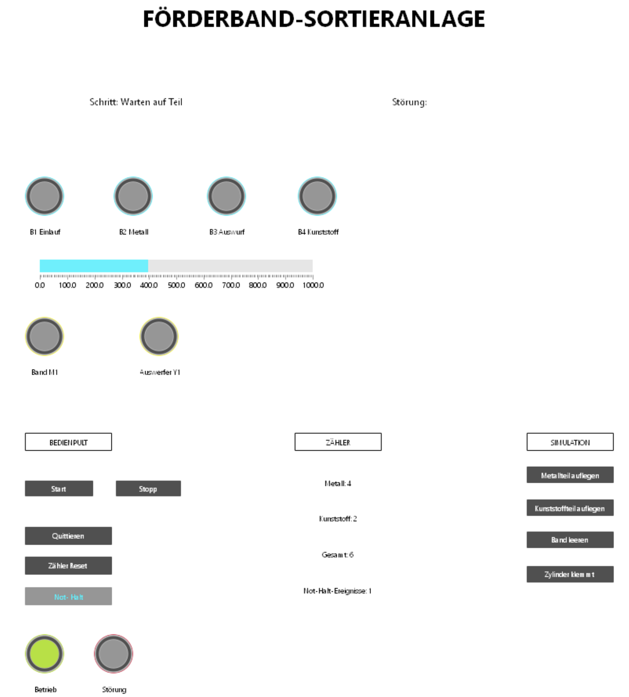
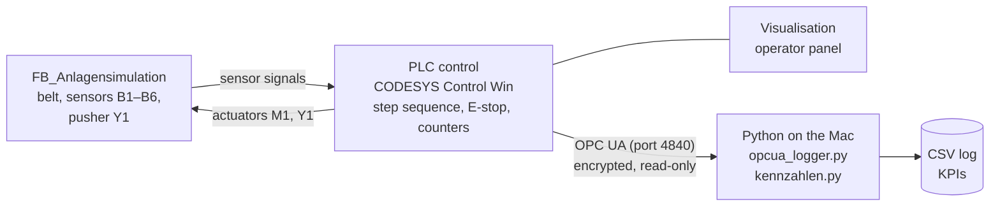
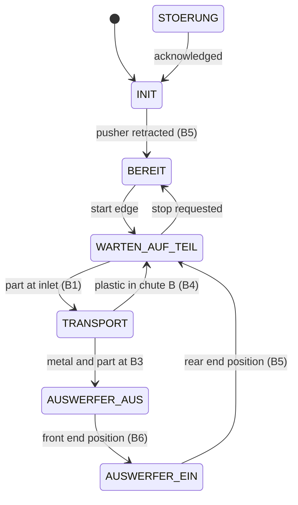

# PLC-Controlled Conveyor Sorting Station (CODESYS, Structured Text)

🇩🇪 [Deutsche Version](README.md)

Self-directed project in PLC programming according to IEC 61131-3. A simulated conveyor sorting station
separates metal and plastic parts, counts them, and provides process data via **OPC UA**.
A Python script reads this data over an encrypted connection, logs it and calculates KPIs.



## Features

- **Step sequence** in Structured Text (ENUM + CASE) with home position, start on a rising edge and stop at end of cycle
- **Sorting**: an inductive sensor detects metal, a pneumatic pusher ejects metal parts into chute A, plastic parts run to the end of the belt into chute B
- **Counters** for metal, plastic and total, exactly once per part
- **Emergency stop** (normally closed, wire-break safe) with acknowledgement and restart interlock
- **Step monitoring**: a timeout during transport or at the pusher's end positions triggers a fault with a plain-text message
- **Visualisation** in CODESYS: operator panel, sensor and actuator states, counters, fault text
- **Plant simulation** as a separate function block, independent of the control logic (virtual commissioning)
- **OPC UA connection**: Python logger (`asyncua`) reads status and counters every second, encrypted with Basic256Sha256 and user authentication, read-only
- **KPIs** from the log: throughput, metal share, emergency stop events, downtime, mean cycle time

## System overview



The PLC runs in a Windows 11 ARM VM (UTM) on a MacBook; the Python client runs directly on macOS.
This mirrors the typical separation between machine control (OT) and data evaluation (IT).

## Step sequence



From every step, an emergency stop or a timeout leads to `STOERUNG` (fault).
After acknowledgement, the station returns to its home position and waits for a new start.

## Results

All tests T1–T9 passed, see the [test record](docs/testprotokoll.md) (German).

Example evaluation of a test run ([`python/logs/beispiel_log.csv`](python/logs/beispiel_log.csv)):

| KPI | Value |
|---|---|
| Duration | 1.75 min |
| Parts total | 5 (3 metal, 2 plastic) |
| Throughput | 2.86 parts/min |
| Emergency stop events | 1 |
| Downtime due to faults | 15.3 s |
| Mean cycle time per part | 4.6 s |

## Project structure

| Folder | Contents |
|---|---|
| [`docs/`](docs) | [Requirements](docs/lastenheft.md), [I/O list](docs/zuordnungsliste.md), [test record](docs/testprotokoll.md) (German) |
| [`plc/`](plc) | PLC code as readable `.st` files and the CODESYS project file, see [overview](plc/README.md) |
| [`python/`](python) | OPC UA logger, KPI evaluation, example log |

## Running it

**PLC:** open `plc/Foerderband_Sortieranlage.project` in CODESYS V3.5 SP22. For tests without a runtime,
*Online → Simulation* is enough. OPC UA requires CODESYS Control Win (2 h runtime without a licence),
with a symbol configuration, a server certificate for the OPC UA server and TCP port 4840 opened.

**Python:**

```
python3 -m venv .venv
source .venv/bin/activate
pip install -r python/requirements.txt
python python/opcua_logger.py <PLC IP> <user> <password>
python python/kennzahlen.py
```

On first start, the logger creates a client certificate in `python/certs/` (not in the repository).
It has to be trusted once in CODESYS (Security Screen → Quarantined → Trusted).

## Limitations

- Pure simulation, no real hardware or fieldbus connection.
- The plant model (`FB_Anlagensimulation`) is simplified, e.g. only one part on the belt at a time.
- The emergency stop logic covers only the **functional** side. A real machine requires
  safety-rated hardware (safety relay or safety PLC according to EN ISO 13849 / EN 60204-1).
- No manual/automatic mode switching, no recipes, no MES or database connection.

## Tools

CODESYS V3.5 SP22 (simulation and CODESYS Control Win), Windows 11 ARM in UTM, Python 3, `asyncua`.
