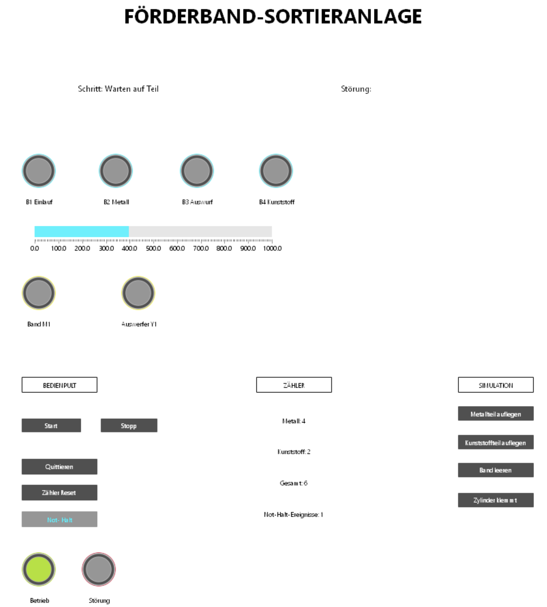
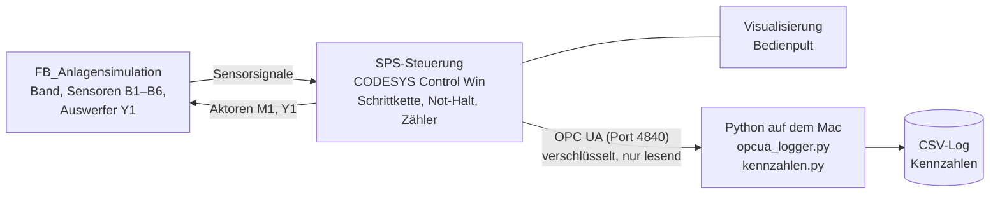
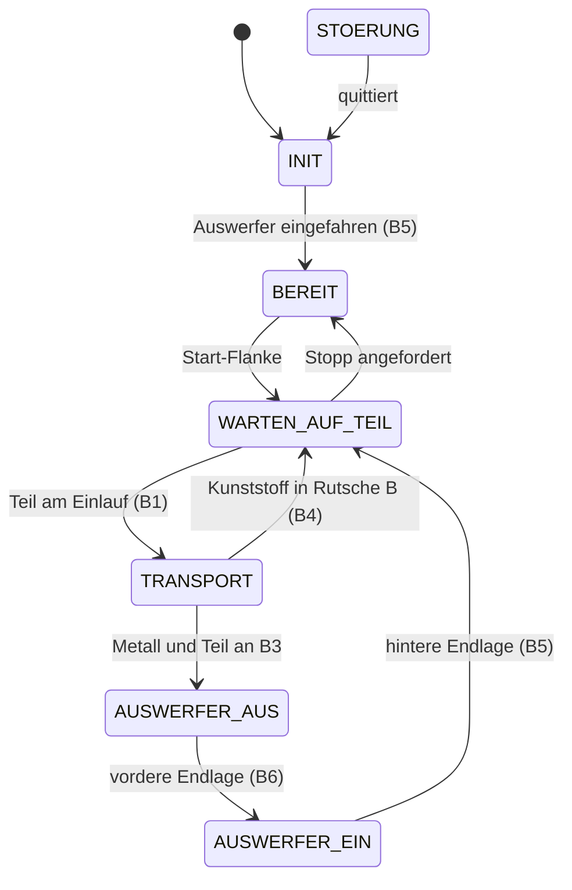

# SPS-gesteuerte Förderband-Sortieranlage (CODESYS, Structured Text)

🇬🇧 [English version](README.en.md)

Eigenprojekt zur SPS-Programmierung nach IEC 61131-3. Eine simulierte Förderband-Sortieranlage
trennt Metall- und Kunststoffteile, zählt sie und stellt Prozessdaten per **OPC UA** bereit.
Ein Python-Skript liest diese Daten verschlüsselt aus, protokolliert sie und berechnet Kennzahlen.



## Funktionsumfang

- **Schrittkette** in Structured Text (ENUM + CASE) mit Grundstellung, Start per steigender Flanke und Stopp am Zyklusende
- **Sortierung**: induktiver Sensor erkennt Metall, ein pneumatischer Auswerfer schiebt Metallteile in Rutsche A, Kunststoffteile laufen bis zum Bandende in Rutsche B
- **Zähler** für Metall, Kunststoff und Gesamt, je Teil genau einmal
- **Not-Halt** (Öffner, drahtbruchsicher) mit Quittierung und Wiederanlaufsperre
- **Schrittüberwachung**: Zeitüberschreitung beim Transport oder an den Endlagen des Auswerfers führt zur Störung mit Klartextmeldung
- **Visualisierung** in CODESYS: Bedienpult, Sensor- und Aktorzustände, Zähler, Störungstext
- **Anlagensimulation** als eigener Funktionsbaustein, getrennt von der Steuerung (virtuelle Inbetriebnahme)
- **OPC-UA-Anbindung**: Python-Logger (`asyncua`) liest Zustand und Zähler im Sekundentakt, verschlüsselt mit Basic256Sha256 und Benutzeranmeldung, nur lesend
- **Kennzahlen** aus dem Log: Durchsatz, Metallanteil, Not-Halt-Ereignisse, Stillstandszeit, mittlere Zykluszeit

## Systemübersicht



Die SPS läuft in einer Windows-11-ARM-VM (UTM) auf einem MacBook, der Python-Client direkt auf macOS.
Das entspricht der typischen Trennung zwischen Maschinensteuerung (OT) und Auswertung (IT).

## Schrittkette



Aus jedem Schritt führt ein Not-Halt oder eine Zeitüberschreitung in `STOERUNG`.
Nach dem Quittieren fährt die Anlage in die Grundstellung und wartet auf einen neuen Start.

## Ergebnisse

Alle Tests T1–T9 bestanden, siehe [Testprotokoll](docs/testprotokoll.md).

Beispielauswertung eines Testlaufs ([`python/logs/beispiel_log.csv`](python/logs/beispiel_log.csv)):

| Kennzahl | Wert |
|---|---|
| Messdauer | 1,75 min |
| Teile gesamt | 5 (3 Metall, 2 Kunststoff) |
| Durchsatz | 2,86 Teile/min |
| Not-Halt-Ereignisse | 1 |
| Stillstand durch Störungen | 15,3 s |
| Mittlere Zykluszeit je Teil | 4,6 s |

## Projektstruktur

| Ordner | Inhalt |
|---|---|
| [`docs/`](docs) | [Lastenheft](docs/lastenheft.md), [Zuordnungsliste](docs/zuordnungsliste.md), [Testprotokoll](docs/testprotokoll.md) |
| [`plc/`](plc) | SPS-Code als lesbare `.st`-Dateien und CODESYS-Projektdatei, siehe [Übersicht](plc/README.md) |
| [`python/`](python) | OPC-UA-Logger, Kennzahlenauswertung, Beispiel-Log |

## Ausführen

**SPS:** `plc/Foerderband_Sortieranlage.project` in CODESYS V3.5 SP22 öffnen. Für Tests ohne Runtime
genügt *Online → Simulation*. Für OPC UA wird CODESYS Control Win benötigt (ohne Lizenz 2 h Laufzeit),
mit Symbolkonfiguration, Serverzertifikat für den OPC-UA-Server und freigegebenem TCP-Port 4840.

**Python:**

```
python3 -m venv .venv
source .venv/bin/activate
pip install -r python/requirements.txt
python python/opcua_logger.py <IP der SPS> <Benutzer> <Passwort>
python python/kennzahlen.py
```

Beim ersten Start erzeugt der Logger ein Client-Zertifikat in `python/certs/` (nicht im Repository).
Dieses muss in CODESYS einmalig als vertrauenswürdig markiert werden (Security Screen → Quarantined → Trusted).

## Grenzen des Projekts

- Reine Simulation, keine reale Hardware oder Feldbusanbindung.
- Das Anlagenmodell (`FB_Anlagensimulation`) bildet die Anlage vereinfacht ab, z. B. nur ein Teil gleichzeitig auf dem Band.
- Die Not-Halt-Logik bildet nur die **funktionale** Seite ab. Eine reale Maschine benötigt
  sicherheitsgerichtete Hardware (Sicherheitsrelais bzw. Sicherheits-SPS nach EN ISO 13849 / EN 60204-1).
- Kein Hand-/Automatikbetrieb, keine Rezepturen, keine Anbindung an MES oder Datenbank.

## Werkzeuge

CODESYS V3.5 SP22 (Simulation und CODESYS Control Win), Windows 11 ARM in UTM, Python 3, `asyncua`.
